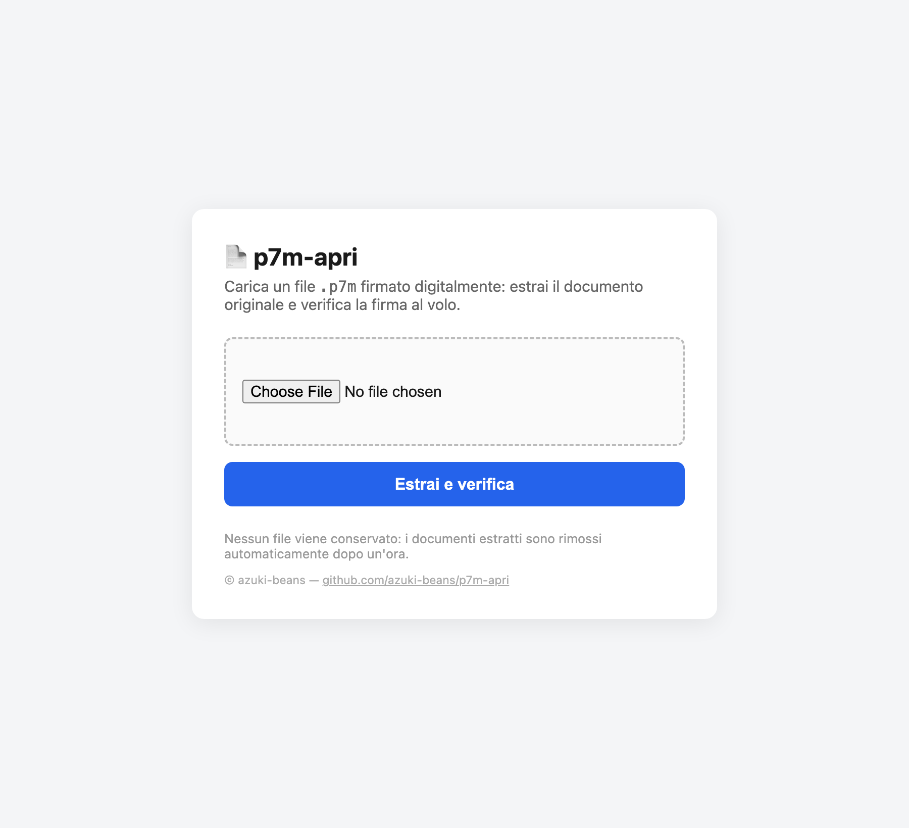
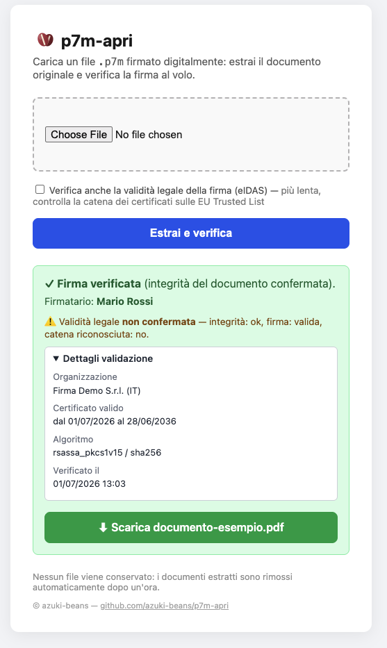
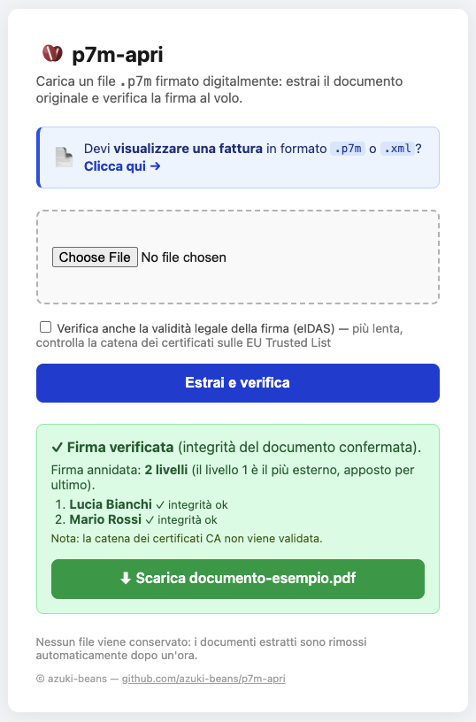
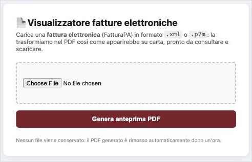
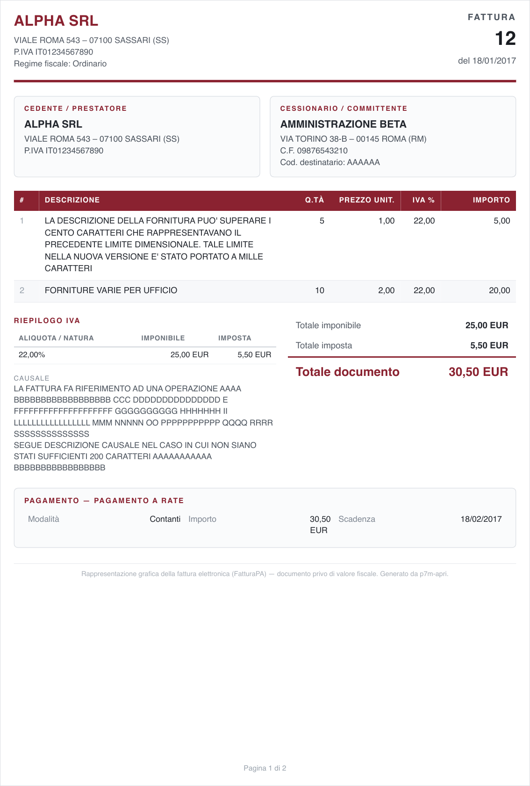
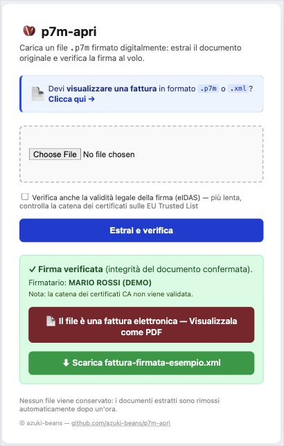

<p align="center">
  
</p>

<p align="center">
  <a href="https://github.com/azuki-beans/p7m-apri/tags"></a>
  <a href="https://github.com/azuki-beans/p7m-apri/pkgs/container/p7m-apri"></a>
  <a href="LICENSE"></a>
</p>

# p7m-apri

Extract the original document (usually a PDF) from a `.p7m` file, the CAdES digitally signed
format that has legal value in Italy. Upload the `.p7m`, the app pulls out the document and
verifies the signature. All in the browser, in a few seconds.

> **Live demo:** <https://p7m.azukibeans.dev>
> Try it right away, nothing to install. It is a demo instance: do not upload confidential
> documents, and keep in mind that the first eIDAS check can be slow (the instance scales to zero
> when idle).

> No file is kept: extracted documents are deleted automatically after one hour.

The user interface is in Italian.

By ticking **"Verifica anche la validità legale della firma (eIDAS)"** (also verify the legal
validity of the signature) the app does not stop at integrity: it checks that the signer's
certificate is recognised by the EU Trusted Lists (qualified trust service providers, including
the Italian ones accredited by AgID). This check is slower and needs an Internet connection.



Here is the result of a successful verification. The signer's data is **fictitious**, generated
with a test certificate:



> Want to try without using one of your documents? The repository contains a sample file signed
> with a made-up identity:
> [`docs/esempio/documento-esempio.pdf.p7m`](docs/esempio/documento-esempio.pdf.p7m).
> Upload it to the app to reproduce the screenshot above.

### Nested and multiple signatures

Sometimes an already signed document is signed again by someone else (`documento.pdf.p7m.p7m` and
so on, a "matryoshka" of signatures): the app unpacks every level down to the original document
and shows, for each level, the signers and the integrity result. Level 1 is the outermost, i.e.
the last signature applied. **Parallel signatures** (several signers on the same level) are
recognised too, and with the eIDAS check enabled every level and every signer is validated
separately.



> To try it: [`docs/esempio/documento-esempio.pdf.p7m.p7m`](docs/esempio/documento-esempio.pdf.p7m.p7m)
> is the sample file above signed a second time by another made-up identity.

## Viewing electronic invoices (XML → PDF)

The same app includes an **Italian electronic invoice viewer**: upload a **FatturaPA** invoice as
`.xml` (or a signed `.p7m`) and see it laid out as it would look **on paper**, ready to download as
PDF. It lives at **`/fatture/`** or via the link on the home page. Parsing is done by
[fatturapa](https://github.com/azuki-beans/fatturapa).

<p align="center">
  
  &nbsp;
  
</p>

> **Try it:** the repository contains some sample invoices (the official samples from the Italian
> Revenue Agency) in [`test_samples/`](test_samples/). Upload an `.xml` one to reproduce the
> screenshot above.

### From a `.p7m` to its invoice

Invoices often arrive signed as `.p7m`. If you open a `.p7m` from the home page and its content is
an invoice, the app notices and offers to **view it as PDF** in one click, with no manual
extraction (alternatively, upload the `.p7m` directly at `/fatture/`). The repository contains a
sample signed with a made-up identity:
[`test_samples/fattura-firmata-esempio.xml.p7m`](test_samples/fattura-firmata-esempio.xml.p7m).

<p align="center">
  
</p>

### Customising the look

The PDF adapts to your company brand through two environment variables: `FATTURA_ACCENT` (main
colour in HEX) and `FATTURA_LOGO_URL` (URL of the logo shown in the header). See the table below.

### Using it as an API

The same service is available over HTTP: `POST` an `.xml` or `.p7m` invoice and get the PDF back.

```bash
# multipart file
curl -F file=@fattura.xml http://localhost:8000/fatture/api/pdf/ -o fattura.pdf

# raw bytes in the body, with a custom theme colour (%23 = '#')
curl --data-binary @fattura.xml.p7m \
     "http://localhost:8000/fatture/api/pdf/?accent=%231D4ED8" -o fattura.pdf
```

Optional query parameters: `accent` (theme HEX), `dl=1` to force download, `filename` for a raw
body. On error the response is JSON `{"error": …}`.

## Quick start (local)

All you need is [Docker](https://docs.docker.com/get-docker/) **or**
[Podman](https://podman.io/). Nothing else to install or download: the image is ready on GitHub.

```bash
# Docker
docker run --rm -p 8000:8000 -v p7m-apri-data:/data ghcr.io/azuki-beans/p7m-apri:latest

# Podman
podman run --rm -p 8000:8000 -v p7m-apri-data:/data ghcr.io/azuki-beans/p7m-apri:latest
```

Then open **<http://localhost:8000>** and upload your `.p7m`.

## Running it on a server (Docker Compose)

```bash
git clone https://github.com/azuki-beans/p7m-apri.git
cd p7m-apri

cp .env.example .env       # set at least DJANGO_SECRET_KEY
docker compose up -d       # with Podman: podman compose up -d
```

The service restarts on its own (`restart: unless-stopped`) and keeps its database in the
`p7m-apri-data` volume. To update to the latest version:
`docker compose pull && docker compose up -d`.

### Environment variables

| Variable | Purpose |
|---|---|
| `DJANGO_SECRET_KEY` | Secret key (required in production). |
| `DJANGO_ALLOWED_HOSTS` | Allowed hostnames, e.g. `p7m.example.com`. |
| `CSRF_TRUSTED_ORIGINS` | Trusted origins with scheme, e.g. `https://p7m.example.com`. |
| `SITE_URL` | Public URL with scheme, e.g. `https://p7m.example.com`: used for canonical, `sitemap.xml` and `robots.txt` (empty = request host). |
| `DJANGO_DEBUG` | `1`/`0` (default `0`). |
| `DJANGO_DB_PATH` | Path of the SQLite database. |
| `TRUST_LIST_CACHE_DIR` | Cache of the EU Trusted Lists for eIDAS validation. |
| `TRUST_LIST_TERRITORIES` | Trusted List countries, e.g. `IT` (default) or `IT,FR`; empty = the whole EU. |
| `SIGNATURE_REVOCATION_MODE` | Revocation check: `soft-fail` (default), `hard-fail`, `require`. |
| `SIGNATURE_TIME_TOLERANCE` | Tolerance in seconds on OCSP/CRL times (default `60`); raise it if the server clock is inaccurate. |
| `FATTURA_ACCENT` | Main colour of the invoice PDF in HEX (default `#8A2230`). |
| `FATTURA_LOGO_URL` | Absolute URL of the company logo shown in the invoice header. |
| `PORT` | Port to listen on (default `8000`); Cloud Run and similar platforms set it themselves. |
| `UMAMI_SRC` | Umami script URL (e.g. `https://cloud.umami.is/script.js`); empty = no analytics. |
| `UMAMI_WEBSITE_ID` | Umami website ID; set it together with `UMAMI_SRC`. |

## Free deploy on Google Cloud Run

Cloud Run runs the container without volumes and scales to zero when nobody is using it (it fits
in the free tier). All you need is the [gcloud SDK](https://cloud.google.com/sdk/docs/install) and
a GCP project, then `gcloud run deploy p7m-apri --source .`.

👉 **Step-by-step guide:** [docs/deploy-cloud-run.md](docs/deploy-cloud-run.md): first deploy,
domain/CSRF and secret key with Secret Manager.

## Building the image from source

If you prefer to build it yourself instead of using the public one:

```bash
git clone https://github.com/azuki-beans/p7m-apri.git
cd p7m-apri
docker build -t p7m-apri .
docker run --rm -p 8000:8000 -v p7m-apri-data:/data p7m-apri
```

## Releases

The version shown by the badge at the top is the latest **Git tag** `vX.Y.Z`. Pushing a tag is
also what **starts the build**: the GitHub Actions workflow builds the multi-arch image and
publishes it on `ghcr.io` tagged with the version (`vX.Y.Z`, `X.Y.Z`) and `latest`.

To release a new version:

```bash
# align the version in pyproject.toml, then create and push the tag
git tag v0.1.0
git push origin v0.1.0
```

## How it works (under the hood)

Behind the scenes it is a single OpenSSL call:

```bash
openssl smime -verify -in documento.pdf.p7m -inform DER -noverify -out documento.pdf
```

- `-inform DER`: `.p7m` files are DER-encoded.
- `-noverify`: skips CA chain validation (so no root certificates need to be installed), but
  signature integrity is still verified.
- The output name keeps the inner extension: `documento.pdf.p7m` → `documento.pdf`. If the `.p7m`
  did not include it (`documento.p7m`), the output will be `documento` and you will have to add
  the extension by hand.
- For a nested `.p7m` (`documento.pdf.p7m.p7m`) the command must be repeated once per level: the
  output of the first pass is itself a `.p7m`.

## Contributing

Bug reports, ideas and pull requests are welcome. How to take part, code conventions and response
times are in [CONTRIBUTING.md](CONTRIBUTING.md); by participating you agree to the
[code of conduct](CODE_OF_CONDUCT.md).

For **security vulnerabilities, do not open a public issue**: follow the private procedure in
[SECURITY.md](SECURITY.md).

Changes in each version are listed in [CHANGELOG.md](CHANGELOG.md).

## Open source software for the Italian public administration

The project is published according to AGID's
[guidelines on acquisition and reuse of software for public administrations](https://docs.italia.it/italia/developers-italia/lg-acquisizione-e-riuso-software-per-pa-docs/).
Its metadata is described in [`publiccode.yml`](publiccode.yml) following the
[publiccode.yml standard](https://yml.publiccode.tools/), the format used by the
[Developers Italia](https://developers.italia.it/) catalogue.

Any public administration can therefore **freely reuse** this software: the MIT license allows
use, modification and redistribution with no prior authorisation and no licence fees. The
application installs as a single container image and needs no proprietary components.

## License

Released under the [MIT](LICENSE) license. © azuki-beans.
